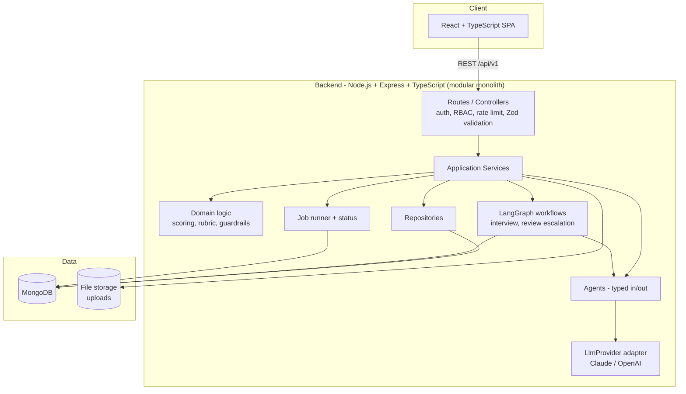
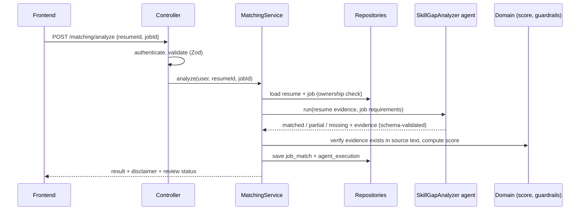
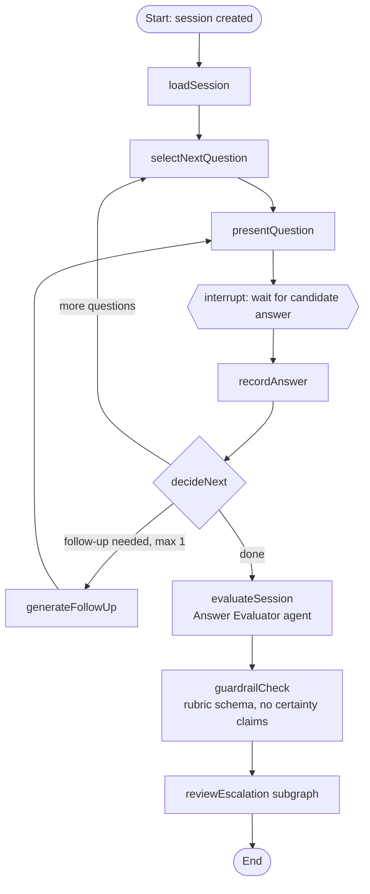
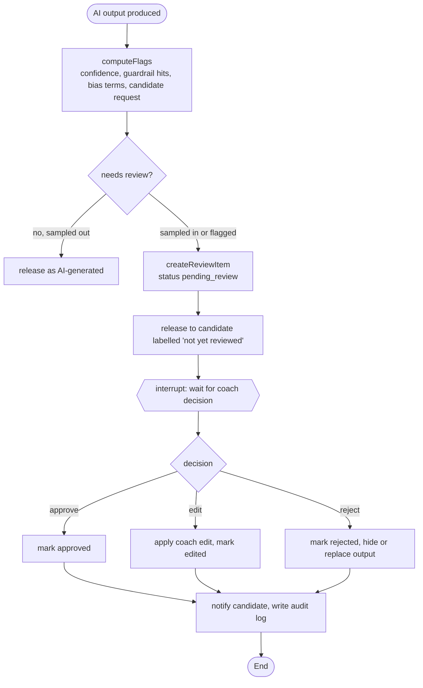

# AI Resume and Interview Coach - Architecture, Structure and Phased Plan

> Capstone Project 04. An AI career-preparation app that parses a resume, analyzes a job description, finds skill gaps, suggests **truthful** resume improvements, and runs mock interviews with rubric-based feedback - with a human Career Coach reviewing flagged AI output.

**Legend used in this document**
- **[Spec]** - required by the project document.
- **[Proposed]** - my design decision or addition. Confirm with your instructor in Phase 2.

---

# 1. Project Overview

## 1.1 What the system does

| Capability | Summary |
|---|---|
| Resume parsing | Accepts PDF/DOCX, extracts structured data, **keeps source text** for verification |
| Job description analysis | Pasted or uploaded text -> role, experience range, required/preferred skills, responsibilities |
| Matching | Matched / partial / missing skills, each with resume evidence |
| Explainable score | Weighted breakdown, labelled *indicative assessment*, not a hiring decision |
| Skill gap analysis | Gaps by category + learning actions; absence from a resume is **not** proof of a missing skill |
| Resume improvement | Factual edits only; candidate accepts or rejects each one |
| Question generation | Technical, project-based, scenario, behavioural, role-specific |
| Mock interview | One question at a time, typed answers (speech-to-text optional, separate service) |
| Answer evaluation | Rubric: relevance, completeness, reasoning, examples, communication |
| Progress and privacy | Consent, history, data export and deletion |

**Hard rule:** the system never fabricates experience, credentials or achievements.

**Current implementation note (2026-11-19):** The API currently persists application collections to a local JSON file and keeps graph checkpoints in process memory. This is temporary for development; MongoDB is planned for a later migration. See [Database Design](docs/architecture/Database-Design.md) for the active storage format and limitations.

## 1.2 Roles

| Role | Type | Responsibilities |
|---|---|---|
| Candidate | Human | Uploads resume, picks a job, reviews gaps, practises interviews |
| Career Coach / Reviewer | Human (confirmed by instructor) | Reviews **flagged** AI output - approves, edits or rejects, adds guidance. Not a 24/7 reviewer, so review is asynchronous |
| Administrator | Human | Users, configuration (models, thresholds), retention, audit logs. Should not read candidate content by default [Proposed] |
| AI agents | Software | Do the bulk of the work as the coach's assistant; never presented as coach-approved until a coach approves |

---

# 2. Key Architecture Decisions

| # | Decision | Reason |
|---|---|---|
| D1 | **Modular monolith** (one backend, isolated domain modules) [Spec] | Simple to run and demo; no premature microservices |
| D2 | **Evidence-first data model**: parser stores each claim with its exact source snippet | Suggestions and matches can be checked against real text, which blocks fabrication in code |
| D3 | **Scores computed by code**, not by the LLM. The model finds matches; a weighted formula produces the number | Explainable, repeatable, configurable [Spec] |
| D4 | **Guardrails enforced in code** (fabrication check, hiring-language filter, schema validation), not only prompts | Prompts alone are not reliable |
| D5 | **LangGraph only where the flow has state, loops or human pauses**: mock interview and coach-review escalation | See section 4 |
| D6 | **Plain service functions** for linear pipelines (parse, analyze, match, gaps, optimize, generate) | A graph adds no value to straight-line steps |
| D7 | **Provider adapter** (`LlmProvider`) for Claude and OpenAI; model chosen by config [Spec] | Swap providers without touching agents |
| D8 | **Async jobs stored in MongoDB** with status polling [Proposed] | Long AI tasks without adding Redis or a queue service |
| D9 | **Review is asynchronous**: AI output is shown immediately, labelled "AI-generated, not yet reviewed" [Proposed] | The coach is not available 24/7 |
| D10 | **Prompts, thresholds, rubric and weights externalized and versioned** [Spec] | Changes are auditable |

---

# 3. System Architecture

## 3.1 High-level view



**Rules**
- The browser talks **only** to the backend. LLM keys and DB access never reach the client [Spec].
- Dependencies point inward: routes -> services -> domain/repositories/agents. Domain logic imports nothing from Express or the DB.
- Agents never touch the DB directly; services load and save data.

## 3.2 Layers

| Layer | Responsibility | Example |
|---|---|---|
| Routes / controllers | HTTP only: parse, validate, call a service, shape the response | `resumes.routes.ts` |
| Application services | Orchestrate a use case, enforce ownership, call agents/repos | `matching.service.ts` |
| Domain | Pure logic, easy to unit test | `score.calculator.ts`, `fabrication.check.ts` |
| Repositories | All MongoDB access | `resumes.repository.ts` |
| Agents | One bounded AI task with typed input/output and execution tracking | `resume-parser/agent.ts` |
| Graphs | LangGraph workflows that need state, loops or human pauses | `graphs/mock-interview.graph.ts` |
| Infra | DB, storage, LLM adapters, job runner, logging | `infra/llm/` |

## 3.3 Typical request flow (match analysis)



---

# 4. Where LangGraph Is Used (and Where It Is Not)

## 4.1 Decision table

| Workflow | Shape | Tool | Why |
|---|---|---|---|
| Resume parsing | Linear | Plain service + agent | No state or branching |
| JD analysis | Linear | Plain service + agent | Same |
| Matching and skill gaps | Linear | Plain service + agent | Same |
| Resume optimization | Linear + code checks | Plain service + agent | Same |
| Question generation | Linear | Plain service + agent | Same |
| **Mock interview** | **Loop with waiting for a human answer** | **LangGraph** | Persistent state, loop, pause/resume per answer |
| **Review escalation** | **Branch + wait for the coach (hours/days)** | **LangGraph** | Human-in-the-loop interrupt and resume |

## 4.2 Mock interview graph



**How it works with REST**
- `POST /interviews` starts the graph with `thread_id = sessionId`; it runs until the first interrupt and returns the first question.
- `POST /interviews/:id/answer` **resumes** the same thread with the answer; the graph records it and returns the next question.
- `POST /interviews/:id/evaluate` can resume the thread into the evaluation branch (also allowed if the candidate ends early).
- Order of questions and answers is enforced by the graph state **and** by checks in the service (answering a question out of sequence returns 409).

**State (keep it small - IDs, not content)**

```ts
type InterviewState = {
  sessionId: string;
  candidateId: string;
  questionIds: string[];      // ordered
  currentIndex: number;
  answerIds: string[];        // ordered
  followUpCount: number;      // capped
  status: 'in_progress' | 'evaluating' | 'completed' | 'abandoned';
  executionIds: string[];
};
```

Source of truth for content stays in `interview_sessions` / `interview_answers`. The checkpoint holds only execution state.

## 4.3 Review escalation graph



**Escalation triggers** (thresholds live in config, editable by admin)

| Trigger | Example |
|---|---|
| Low confidence | Parser flagged an uncertain field; weak evidence for a skill match |
| Guardrail hit | Possible claim not found in the resume; hiring-decision wording |
| Possible bias | Output touches age, gender, nationality or other protected traits |
| Candidate request | "Ask a coach to review this" button |
| Dispute | Candidate disputes a score or evaluation |
| Random sample | Small percentage for quality monitoring |

Review item statuses: `not_required` - `pending_review` - `approved` - `edited` - `rejected`.

## 4.4 LangGraph practicalities

- Packages: `@langchain/langgraph` and `@langchain/core`. Use a MongoDB checkpointer so state survives restarts. **Check the current docs for exact package names and versions before Phase 5** - the JS ecosystem changes quickly.
- Graph nodes call the **same `LlmProvider` adapter** and the same agents as the rest of the app. LangGraph is the orchestrator, not a second AI layer.
- Every node that calls an agent writes an `agent_executions` record (execution ID, agent, status, duration, tokens, error).
- Keep graph code in `backend/src/graphs/`; keep business rules in services and domain so they can be unit tested without LangGraph.
- Fallback if time runs short: implement the interview as a small state machine in `interviews.service.ts` and keep LangGraph for review escalation only. Ask your instructor whether LangGraph is acceptable (the spec names LangChain.js or a custom layer).

---

# 5. Agents

| Agent | Input -> Output | Runs in |
|---|---|---|
| Resume Parser | file text -> structured resume + evidence snippets + uncertainty flags | Service |
| Job Description Analyzer | JD text -> role, experience range, required/preferred skills, responsibilities | Service |
| Skill Gap Analyzer | resume evidence + JD -> matched/partial/missing + evidence + gap categories | Service |
| Resume Coach | resume + JD + gaps -> suggestions (original, proposed, reason, source snippet) | Service + fabrication check |
| Question Generator | resume + JD -> questions by competency and difficulty | Service |
| Mock Interview | session state -> next question / follow-up | **LangGraph** |
| Answer Evaluator | question + answer -> rubric scores, strengths, improvements, example answer | **LangGraph** node |
| Career Guidance | gaps + evaluation -> learning and practice plan | Service |

**Shared agent runtime** (`agents/runtime/`): input validation, prompt loading by version, provider call, Zod output validation, one retry on invalid output, timeout, execution record. Each agent folder contains `agent.ts`, `schema.ts` (Zod in/out) and a reference to its prompt file.

**Guardrails (code)**
- **Fabrication check:** every proposed bullet's numbers, employers, titles and credentials must exist in the resume; otherwise rejected before the candidate sees it.
- **Evidence check:** every matched skill must cite a snippet that exists in the source text.
- **Language filter:** blocks hiring-decision and outcome-guarantee wording (ATS pass rate, "you will be hired").
- **Protected traits:** never passed to scoring; flagged if they appear in output.
- **Untrusted input:** resume/JD text goes to the model as delimited data, never as instructions.

---

# 6. Project File Structure

```text
ai-resume-interview-coach/
├── README.md
├── docker-compose.yml
├── .env.example
├── .gitignore
├── docs/
│   ├── initial-assessment.md
│   ├── architecture/
│   │   ├── Architecture.md
│   │   ├── HLD.md
│   │   ├── LLD.md
│   │   ├── Component-Design.md
│   │   ├── Data-Flow.md
│   │   ├── Database-Design.md
│   │   ├── Security-Architecture.md
│   │   └── diagrams/
│   ├── api/
│   │   ├── API-Specification.md
│   │   └── openapi.yaml
│   └── test-evidence/
├── postman/
│   └── AI-Resume-Interview-Coach.postman_collection.json
├── backend/
│   ├── package.json
│   ├── tsconfig.json            # strict mode
│   ├── Dockerfile
│   ├── src/
│   │   ├── server.ts            # start HTTP server
│   │   ├── app.ts               # Express app, middleware wiring
│   │   ├── config/              # env.ts (Zod-validated), thresholds, feature flags
│   │   ├── common/
│   │   │   ├── errors/          # AppError, error codes
│   │   │   ├── middleware/      # auth, rbac, validate, rateLimit, requestId, errorHandler, upload
│   │   │   ├── logger/          # structured logger, redaction
│   │   │   └── types/
│   │   ├── infra/
│   │   │   ├── db/              # mongo connection, index setup
│   │   │   ├── storage/         # file storage adapter (local / S3)
│   │   │   ├── llm/             # LlmProvider interface, claude.provider.ts, openai.provider.ts
│   │   │   ├── jobs/            # job runner, job status model
│   │   │   └── files/           # PDF/DOCX text extraction, file-type sniffing
│   │   ├── modules/             # one folder per domain
│   │   │   ├── health/
│   │   │   ├── auth/
│   │   │   ├── users/
│   │   │   ├── candidates/
│   │   │   ├── resumes/
│   │   │   ├── jobs/            # job descriptions
│   │   │   ├── matching/
│   │   │   ├── skills/          # skill gaps
│   │   │   ├── suggestions/     # resume optimization
│   │   │   ├── interviews/      # questions, sessions, answers, evaluations
│   │   │   ├── reviews/         # coach review queue and decisions
│   │   │   ├── progress/
│   │   │   ├── privacy/         # consent, export, deletion
│   │   │   └── admin/           # users, config, audit log views
│   │   ├── agents/
│   │   │   ├── runtime/         # runAgent(), retries, timeouts, execution tracking
│   │   │   ├── resume-parser/
│   │   │   ├── jd-analyzer/
│   │   │   ├── skill-gap-analyzer/
│   │   │   ├── resume-coach/
│   │   │   ├── question-generator/
│   │   │   ├── mock-interview/
│   │   │   ├── answer-evaluator/
│   │   │   └── career-guidance/
│   │   ├── graphs/              # LangGraph workflows
│   │   │   ├── mock-interview.graph.ts
│   │   │   ├── review-escalation.graph.ts
│   │   │   ├── state/           # state types
│   │   │   └── checkpointer.ts  # MongoDB checkpointer setup
│   │   ├── guardrails/          # fabrication, evidence, language, protected-trait checks
│   │   └── prompts/
│   │       ├── v1/              # one file per agent, versioned
│   │       └── rubric.v1.json   # interview rubric (versioned)
│   ├── scripts/                 # seed data, index creation, admin bootstrap
│   └── tests/
│       ├── unit/
│       ├── integration/         # Supertest
│       ├── contract/            # OpenAPI conformance
│       └── ai-eval/             # golden set + injection cases
│           └── fixtures/
├── frontend/
│   ├── package.json
│   ├── Dockerfile
│   └── src/
│       ├── main.tsx
│       ├── app/                 # router, providers, layout
│       ├── api/                 # typed API client (only place that calls the backend)
│       ├── features/
│       │   ├── auth/
│       │   ├── dashboard/
│       │   ├── resume/          # upload, preview, improvement studio
│       │   ├── jobs/            # job description workspace
│       │   ├── matching/        # match analysis
│       │   ├── interview/       # preparation, mock room, evaluation report
│       │   ├── coach/           # review queue (coach role)
│       │   ├── admin/
│       │   └── settings/        # privacy, consent, export, deletion
│       ├── components/          # shared UI, loading/empty/error states
│       └── hooks/
└── e2e/                         # Playwright tests
```

**Module internals (same shape for every module)**

```text
modules/resumes/
├── resumes.routes.ts        # URL -> controller, middleware
├── resumes.controller.ts    # HTTP in/out only
├── resumes.service.ts       # use-case logic, ownership checks
├── resumes.repository.ts    # MongoDB queries
├── resumes.schema.ts        # Zod request/response schemas
├── resumes.model.ts         # document types / index definitions
└── index.ts
```

---

# 7. Data Model

## 7.1 Collections [Spec] (16)

`users`, `candidates`, `resumes`, `parsed_resume_data`, `job_descriptions`, `job_matches`, `skill_gaps`, `resume_suggestions`, `interview_questions`, `interview_sessions`, `interview_answers`, `interview_evaluations`, `candidate_progress`, `consents`, `agent_executions`, `audit_logs`

## 7.2 Additions [Proposed]

| Collection | Purpose |
|---|---|
| `review_items` | Coach queue: target (type + id), flags, status, assigned coach, decision, reason, timestamps |
| `jobs` | Async job status for long-running AI tasks |
| `prompt_versions` / config in files | Version history of prompts, weights, thresholds |
| `langgraph_checkpoints` | Created by the LangGraph checkpointer (execution state only) |

## 7.3 Rules for every collection
- Document: field names, BSON types, required/optional, indexes, ownership scope, relationships, sample document.
- Every candidate-owned document has `ownerId` (indexed). All queries filter by owner.
- Retention and deletion rules per collection; deletion cascades through resumes, parsed data, matches, sessions, answers, evaluations and progress.
- No raw secrets or unnecessary personal data in `audit_logs` or `agent_executions`.

---

# 8. API Surface

Base path `/api/v1`. All endpoints: Zod validation, authentication, RBAC, ownership checks, OpenAPI entry, documented error responses.

## 8.1 Spec endpoints [Spec]

| Method | Endpoint | Purpose |
|---|---|---|
| POST | `/resumes/upload` | Upload a resume |
| GET | `/resumes/:id` | Parsed resume |
| PATCH | `/resumes/:id` | Correct extracted data |
| POST | `/jobs/analyze` | Analyze a job description |
| POST | `/matching/analyze` | Compare resume with job |
| POST | `/skills/gaps` | Skill gap analysis |
| POST | `/resumes/optimize` | Factual resume suggestions |
| POST | `/interviews/generate` | Generate interview questions |
| POST | `/interviews` | Create mock interview (starts the graph) |
| GET | `/interviews/:id` | Get session |
| POST | `/interviews/:id/answer` | Submit answer (resumes the graph) |
| POST | `/interviews/:id/evaluate` | Evaluate session |
| GET | `/interviews/:id/results` | Evaluation report |
| GET | `/candidates/me/progress` | Progress |
| DELETE | `/candidates/me/data` | Delete candidate data |

## 8.2 Additions [Proposed - not in the spec]

| Method | Endpoint | Purpose |
|---|---|---|
| POST | `/auth/register`, `/auth/login` | Candidate self-registration (role forced to `candidate`) and login |
| GET | `/health` | Health check |
| GET | `/jobs/status/:id` | Poll async job status |
| POST | `/suggestions/:id/decision` | Candidate accepts or rejects a suggestion |
| POST | `/reviews/request` | Candidate asks for coach review |
| GET | `/reviews/pending` | Coach queue |
| POST | `/reviews/:id/decision` | Coach approve / edit / reject |
| GET | `/candidates/me/export` | Data export |
| GET/PATCH | `/admin/users`, `/admin/config`, `/admin/audit-logs` | Admin functions |

---

# 9. Implementation Phases

> **Approval gate for every phase:** demonstrate deliverables, list files created/modified, show actual test results and known issues, then **wait for coach (instructor) approval** before the next phase. Never claim tests passed unless they were run.

## Phase 1 - Repository Assessment

**Goal:** understand what exists before changing anything.

| Tasks | Output |
|---|---|
| Inspect repo: structure, stack, dependencies, scripts | `docs/initial-assessment.md` |
| List reusable code and existing standards | |
| Document gaps against this document | |
| Propose changes; do not overwrite code without justification | |

**Exit checklist**
- [ ] `initial-assessment.md` committed
- [ ] Open questions listed (see section 10)
- [ ] Coach approval

## Phase 2 - Architecture and Contracts

**Goal:** agree the design before coding.

**Files created:** everything under `docs/architecture/`, `docs/api/openapi.yaml` (draft), diagrams.

| Task | Detail |
|---|---|
| Architecture, HLD, LLD, Component-Design, Data-Flow | Use sections 2-6 of this document as the starting point |
| LangGraph design | State types, node list, interrupt points and checkpointing for the two graphs (section 4) |
| Database design | All collections with fields, BSON types, indexes, ownership, samples; retention rules |
| OpenAPI draft | All endpoints incl. error responses and the async job flow |
| Scoring and rubric | Score weights, rubric dimensions, escalation thresholds (config files) |
| Security architecture | Auth, RBAC matrix, file handling, prompt-injection defence, privacy |

**Exit checklist**
- [ ] Review session with coach held **before coding**
- [ ] Decisions on [Proposed] items recorded (auth, review flow, LangGraph, admin scope)
- [ ] Coach approval

## Phase 3 - Backend Foundation

**Goal:** a secure, observable skeleton with no AI yet.

**Files created:** `backend/` scaffold, `config/`, `common/`, `infra/db`, `modules/health`, `modules/auth`, `modules/users`, `docker-compose.yml` (API + MongoDB), `.env.example`.

| Task | Detail |
|---|---|
| Config | Zod-validated env; no secrets in git |
| Database | Mongo connection, index bootstrap script |
| Auth + RBAC | JWT, password hashing, roles candidate / coach / admin, ownership helper |
| Middleware | requestId, validate, rateLimit, errorHandler (no stack traces to clients), upload guard |
| Logging | Structured logs with redaction |
| Health check | `GET /health` |

**Tests:** unit (config, errors), integration (auth, RBAC, 401/403), Postman folder *Phase 3*.

**Exit checklist**
- [ ] App starts with `docker compose up`
- [ ] Unauthenticated access returns 401; candidate cannot self-assign admin
- [ ] Results recorded

## Phase 4 - Core Domain APIs

**Goal:** resume and job-description intake with persistence.

**Files created:** `modules/resumes`, `modules/jobs`, `modules/candidates`, `modules/privacy` (consent), `infra/storage`, `infra/files`, `infra/jobs`.

| Task | Detail |
|---|---|
| Resume upload | PDF/DOCX only; size limit; file-type sniffing (not just extension); secure storage |
| Text extraction | Extract text and keep it as source for verification |
| Resume CRUD | `POST /resumes/upload`, `GET /resumes/:id`, `PATCH /resumes/:id` with ownership checks |
| Job intake | `POST /jobs/analyze` accepts pasted text or upload (storage and validation here; AI extraction wired in Phase 5) |
| Async jobs | Job collection and status endpoint |
| Consent | Capture consent at registration/first upload |

**Tests:** integration (upload types, ownership, validation), Postman folders *Resume intake* and *JD analysis*.

**Exit checklist**
- [ ] Valid resume uploads and is stored; unsupported file rejected
- [ ] Another user cannot read or edit it

## Phase 5 - Agent Workflows (including LangGraph)

**Goal:** all AI features, built as bounded agents with guardrails.

### 5.1 Foundations
**Files:** `infra/llm/`, `agents/runtime/`, `prompts/v1/`, `guardrails/`, `modules/*/agent wiring`.
- `LlmProvider` interface + Claude and OpenAI adapters; model by config.
- `runAgent()` with schema validation, one retry, timeout, execution record.
- Versioned prompts; resume/JD text always passed as delimited data.

### 5.2 Linear agents (plain services)
- Resume Parser, JD Analyzer -> wire into Phase 4 endpoints (parse status + uncertainty flags).
- `POST /matching/analyze`: Skill Gap Analyzer -> evidence check -> **score by code** with breakdown and disclaimer.
- `POST /skills/gaps`: grouped gaps with actions; wording rule - absence is "no evidence found", not "lacks".
- `POST /resumes/optimize`: Resume Coach -> **fabrication check** -> suggestions stored as `pending`; candidate accepts or rejects.
- `POST /interviews/generate`: Question Generator.
- Career Guidance for preparation plans.

### 5.3 LangGraph: mock interview
**Files:** `graphs/mock-interview.graph.ts`, `graphs/state/`, `graphs/checkpointer.ts`, `modules/interviews`, `agents/mock-interview`, `agents/answer-evaluator`.
- Implement the graph from section 4.2 with `thread_id = sessionId`.
- `POST /interviews` starts it; `POST /interviews/:id/answer` resumes it; out-of-order answers rejected (409).
- Evaluation branch uses the versioned rubric; results stored and returned by `GET /interviews/:id/results`.

### 5.4 LangGraph: review escalation [Proposed]
**Files:** `graphs/review-escalation.graph.ts`, `modules/reviews`.
- Flags computed from confidence, guardrail hits, bias terms, candidate request, random sample.
- Items released immediately labelled "not yet reviewed"; graph pauses until the coach decides.
- Endpoints: `/reviews/request`, `/reviews/pending`, `/reviews/:id/decision`. Decisions logged with coach ID, time and reason.

### 5.5 Progress
- `GET /candidates/me/progress`, `candidate_progress` updates after each evaluation.

**Tests:** unit (score calculator, fabrication/evidence checks, language filter), integration (every endpoint, ownership), **AI eval v1** (golden resume/JD pairs, injection cases), Postman folders *Matching*, *Interview*, *Progress*.

**Exit checklist**
- [ ] Every agent output validates against its Zod schema
- [ ] Fabricated claim is blocked in a test
- [ ] Interview preserves order across a server restart (checkpoint works)
- [ ] Flagged output appears in the coach queue

## Phase 6 - Frontend

**Goal:** all screens on real APIs; no static mock data in the final flow.

**Files:** everything under `frontend/src/` (section 6).

| Screen | Notes |
|---|---|
| Auth + Candidate Dashboard | Resume status, recent analyses, sessions, progress |
| Resume Upload and Preview | Parse status, uncertainty flags, edit extracted data |
| Job Description Workspace | Paste or upload |
| Match Analysis | Score breakdown, matched/partial/missing with evidence, disclaimer |
| Resume Improvement Studio | Side-by-side original vs proposed, accept/reject per suggestion |
| Interview Preparation | Question bank, filters, preparation plan |
| Mock Interview Room | One question at a time, timer/status |
| Evaluation Report | Rubric scores, strengths, improvements, example answer; "AI-generated / reviewed by coach" label |
| Coach Review Queue [Proposed] | Pending items with source evidence and flag reasons |
| Privacy and Settings | Consent, export, retention, deletion |
| Admin [Proposed, minimal] | Users and roles, config view, audit log view |

**Quality:** loading, empty, validation-error, failure and success states; accessible and responsive; API client is the only code that calls the backend.

**Exit checklist**
- [ ] Full workflow works through the UI without manual database edits

## Phase 7 - Testing and Evaluation

**Goal:** prove it works; document limits honestly.

| Task | Detail |
|---|---|
| Unit + integration + contract | Jest, Supertest, OpenAPI conformance |
| E2E | Playwright: register -> upload -> JD -> match -> improve -> mock interview -> report -> delete data |
| Postman run | Collection Runner export as evidence |
| AI evaluation | Factual preservation, no fabrication, rubric adherence, prompt-injection resistance (including a resume with hidden instructions), no protected-trait use |
| Security | Auth, RBAC, data isolation, rate limiting, file spoofing, oversized upload |
| Limitations | Written down, including heuristic checks and model variability |

**Files:** `backend/tests/*`, `e2e/`, `docs/test-evidence/`.

**Exit checklist**
- [ ] Evidence saved in the repo
- [ ] Known limitations documented

## Phase 8 - Deployment and Handover

**Goal:** a coach can run it from the docs alone.

**Files:** `docker-compose.yml` (frontend, backend, MongoDB), `Dockerfile`s, `.env.example`, `README.md`, final `docs/`, Swagger served by the API.

| Task | Detail |
|---|---|
| Docker | One-command startup; secrets only via env/secret manager |
| Docs | README with setup/run/test; architecture updated to match what was built |
| Samples | Real API requests **and actual responses** from the running system |
| Deployment notes | AWS or Azure steps |

**Exit checklist**
- [ ] Clean-machine setup works from README only
- [ ] No secrets or real personal data committed

---

# 10. Open Questions for the Instructor

1. Is **LangGraph.js** acceptable for the mock interview and review escalation? (Spec names LangChain.js or a custom layer.)
2. Registration: candidate self-signup, with coaches invited/promoted by an admin and admins seeded?
3. Coach review scope: rule-based escalation, candidate-requested review, or both? Must the candidate wait for review, or see output immediately with a label?
4. How much **admin** functionality is expected (users, config, audit log)?
5. Is data **export** required to be a downloadable file (JSON/ZIP)?
6. Is speech-to-text in scope, or typed answers only?

---

# 11. Definition of Done

- [ ] A coach can run the app from the documented setup
- [ ] Frontend and backend use persistent storage and real APIs
- [ ] Main workflow works end to end without manual database edits
- [ ] AI outputs follow schemas and pass guardrails
- [ ] Authentication, authorization and data isolation are tested
- [ ] Swagger, architecture docs and README match the implementation
- [ ] Test results and limitations are documented
- [ ] No secrets, credentials or real personal data in the repository
