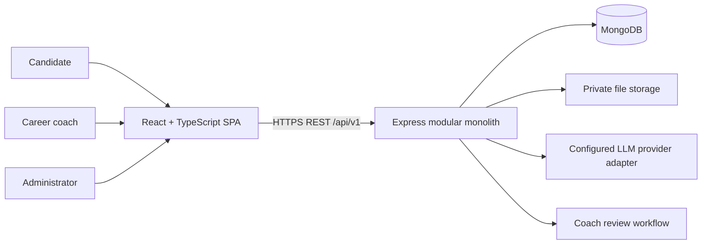

# Architecture

Status: Phase 2 design draft. The user approved proceeding with this phase; instructor review of proposed scoring values and unresolved operational decisions remains outstanding.

## Purpose and scope

The system helps a candidate prepare for a career opportunity by parsing a resume, analyzing a job description, finding evidence-backed skill gaps, suggesting factual resume improvements, and running typed mock interviews. A career coach reviews flagged AI output. The system is a preparation aid, not a hiring decision system.

## Decisions

| ID | Decision | Status |
|---|---|---|
| AD-01 | Build a modular monolith using Node.js, Express, and TypeScript. | Adopted |
| AD-02 | Keep HTTP, application services, domain rules, repositories, agents, and infrastructure in separate inward-facing layers. | Adopted |
| AD-03 | Store source text and evidence references so matches and suggestions can be checked against their inputs. | Adopted |
| AD-04 | Compute numeric scores in deterministic code; an LLM may classify/extract evidence but must not return the final score. | Adopted |
| AD-05 | Enforce schema, evidence, fabrication, protected-trait, and language checks in code. | Adopted |
| AD-06 | Use plain services for linear AI tasks; reserve LangGraph for resumable interviews and coach-review pauses. | Proposed for instructor confirmation |
| AD-07 | Isolate provider-specific APIs behind `LlmProvider`; support provider/model selection through server configuration. | Adopted; provider choice pending |
| AD-08 | Persist long-running work in MongoDB and expose job status polling. | Proposed |
| AD-09 | Show AI results promptly with an explicit unreviewed label; coach review is asynchronous. | Proposed |
| AD-10 | Version prompts, score weights, rubrics, and thresholds. | Adopted |
| AD-11 | Public registration creates candidates only. Coach/admin accounts require controlled provisioning. | Adopted for the design |
| AD-12 | Administrators manage users/configuration/retention/audit metadata and do not read candidate content by default. | Proposed |

## System context

The browser never receives database credentials or LLM provider keys. Only backend services access persistence, storage, or model providers.

## Runtime layers and dependency direction

1. **Routes/controllers** authenticate, validate, and translate HTTP requests/responses.
2. **Application services** enforce use-case orchestration and ownership.
3. **Domain** contains pure scoring, rubric, evidence, and guardrail logic.
4. **Repositories** own MongoDB queries and indexes.
5. **Agents** perform one bounded, typed AI task and cannot access repositories.
6. **Graphs** orchestrate only workflows that pause or loop.
7. **Infrastructure** provides MongoDB, private storage, LLM providers, logging, and job execution.

Dependencies point inward. Domain modules do not import Express, MongoDB, or provider SDKs.

## Trust and data boundaries

- Candidate uploads and job descriptions are untrusted data, never instructions to the model.
- Every candidate-owned document has an `ownerId`; repository queries include it.
- Uploaded files are private, size limited, MIME-sniffed, and stored outside a public web root.
- External model calls are server-side, versioned, and subject to consent and provider data-processing review.
- AI output remains attributable to its source, prompt/config version, provider, and review state.

## Decisions still requiring confirmation

- Instructor acceptance of LangGraph.js and the proposed score/rubric defaults.
- Provider/model selection and provider retention/data-residency requirements.
- Production file-storage provider and retention duration.
- Coach staffing/assignment and admin bootstrap operations.
- Whether export is JSON-only or an archive.

## Relationship to the current scaffold

The current Phase 3 code implements the backend foundation and current-user/auth routes only. It does not yet implement the resume, job, matching, agent, or graph modules described here. The seven-day JWT default is a scaffold setting; before production, set a short-lived access token policy and document refresh/revocation behavior.
