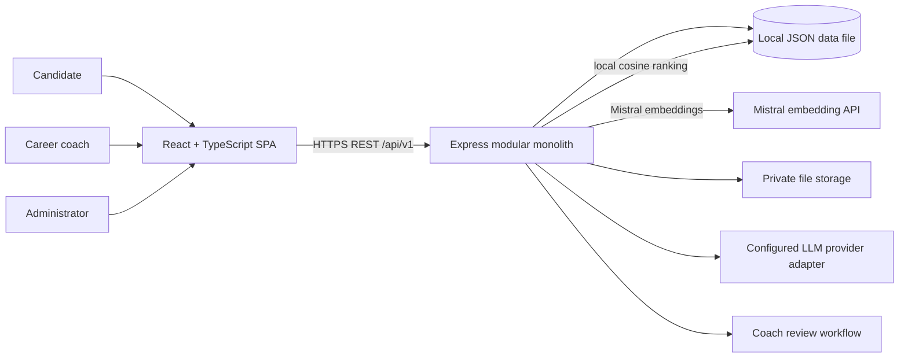

# Architecture

Status: Phase 2 design with core backend workflows implemented. Instructor review of proposed scoring values and unresolved operational decisions remains outstanding.

## Purpose and scope

The system helps a candidate prepare for a career opportunity by parsing a resume, analyzing a job description, finding evidence-backed skill gaps, suggesting factual resume improvements, and running mock interviews with typed or browser-transcribed answers. Interview recording has a two-minute timer that runs only during recording and pauses when capture stops, with up to three speech recording attempts. Optional video practice remains in the browser until the candidate submits the interview for coach review, when the clip is uploaded to private local storage and made available to the coach. A career coach reviews flagged AI output. The system is a preparation aid, not a hiring decision system.

## Decisions

| ID | Decision | Status |
|---|---|---|
| AD-01 | Build a modular monolith using Node.js, Express, and TypeScript. | Adopted |
| AD-02 | Keep HTTP, application services, domain rules, repositories, agents, and infrastructure in separate inward-facing layers. | Adopted |
| AD-03 | Store source text and evidence references so matches and suggestions can be checked against their inputs. | Adopted |
| AD-04 | Compute numeric scores in deterministic code; an LLM may classify/extract evidence but must not return the final score. | Adopted |
| AD-05 | Enforce schema, evidence, fabrication, protected-trait, and language checks in code. | Adopted |
| AD-06 | Use plain services for linear AI tasks; reserve LangGraph for resumable interviews and coach-review pauses. | Proposed for instructor confirmation |
| AD-07 | Isolate provider-specific APIs behind `LlmProvider`; support provider/model selection through server configuration. | Adopted; provider choice pending |
| AD-08 | Persist long-running work in a local JSON file and expose job status polling. | Temporary implementation; MongoDB migration is planned |
| AD-09 | Show AI results promptly with an explicit unreviewed label; coach review is asynchronous. | Proposed |
| AD-10 | Version prompts, score weights, rubrics, and thresholds. | Adopted |
| AD-11 | Public registration creates candidates only. Coach/admin accounts require controlled provisioning. | Adopted for the design |
| AD-12 | Administrators manage users/configuration/retention/audit metadata and do not read candidate content by default. | Proposed |

## System context

The browser never receives database credentials or LLM provider keys. Only backend services access persistence, storage, or model providers.

## Runtime layers and dependency direction

1. **Routes/controllers** authenticate, validate, and translate HTTP requests/responses.
2. **Application services** enforce use-case orchestration and ownership.
3. **Domain** contains pure scoring, rubric, evidence, and guardrail logic.
4. **Repositories** use the JSON persistence adapter; a MongoDB adapter is planned later.
5. **Agents** perform one bounded, typed AI task and cannot access repositories.
6. **Graphs** orchestrate only workflows that pause or loop.
7. **Infrastructure** provides JSON persistence, private storage, LLM providers, logging, and job execution.

Dependencies point inward. Domain modules do not import Express, MongoDB, or provider SDKs.

## Trust and data boundaries

- Candidate uploads and job descriptions are untrusted data, never instructions to the model.
- Every candidate-owned document has an `ownerId`; repository queries include it.
- Uploaded files are private, size limited, MIME-sniffed, and stored outside a public web root.
- External model calls are server-side, versioned, and subject to consent and provider data-processing review.
- Original resume text and evidence are retained in the owner-scoped JSON store. A single `sanitizeForLlm` boundary sanitizes serialized inputs before every LLM call; Mistral receives only four-PII-sanitized chunks for embeddings, while stored vector-chunk content remains original for evidence retrieval and display.
- AI output remains attributable to its source, prompt/config version, provider, and review state.

## Decisions still requiring confirmation

- Instructor acceptance of LangGraph.js and the proposed score/rubric defaults.
- Provider/model selection and provider retention/data-residency requirements.
- Production file-storage provider and retention duration.
- Coach staffing/assignment and admin bootstrap operations.
- Whether export is JSON-only or an archive.

## Relationship to the current scaffold

The backend implements authentication, consent, resume and job-description intake, queued AI workflows, human review, and interview graphs. For now, application data uses a local JSON file, semantic matching uses Mistral embeddings with local cosine ranking, and graph checkpoints remain in memory. MongoDB is planned for a later migration. Coach/admin provisioning, export/deletion workflows, refresh-token revocation, and production deployment validation remain follow-up work. The seven-day JWT default is not a production access-token policy.
