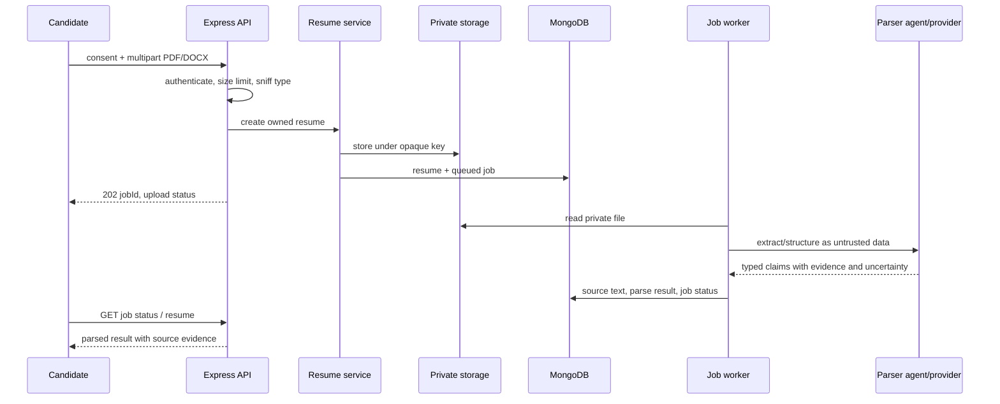
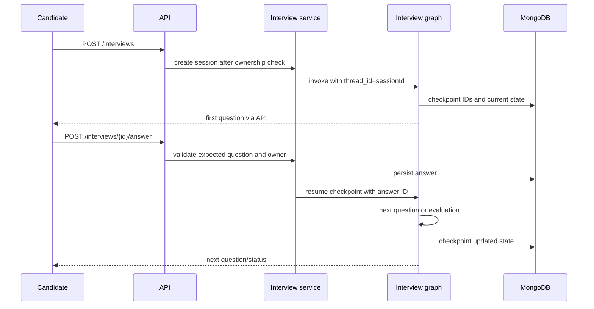

# Data Flow

## Resume intake and parsing

## Job description and match

1. Candidate provides pasted text or an accepted file.
2. Service persists original text and creates an analysis job.
3. Analyzer extracts role, experience, skills, and responsibilities with exact source evidence.
4. Matching service loads candidate-owned resume and job data.
5. Skill classification is checked against source snippets; pure domain code calculates the versioned score.
6. Candidate receives the score breakdown and the disclaimer that it is indicative preparation feedback, not a hiring decision.

## Interview

## Review escalation

1. Code guardrails and configured thresholds determine review flags.
2. The AI output may be shown with an explicit "AI-generated, not yet reviewed" label; it is never described as coach-approved.
3. A review item is created for low confidence, guardrail hits, possible protected-trait content, candidate request/dispute, or quality sampling.
4. The graph interrupts while waiting for an authorized coach decision.
5. The decision, reason, reviewer, timestamp, and final version are persisted and audited.
6. Candidate receives the resulting status and version.

## Data minimization

Only IDs and workflow metadata are placed in graph checkpoints. Source content is fetched by owner-scoped services when needed. Routine logs contain identifiers and safe status metadata, not resume text, passwords, tokens, or answer bodies.
