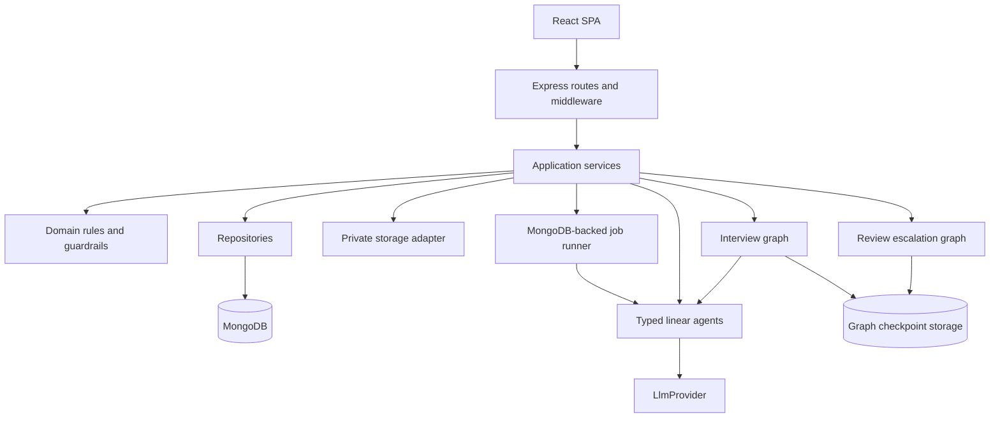

# High-Level Design

## Deployable units

| Unit | Responsibility | Phase |
|---|---|---|
| React SPA | Candidate, coach, and administrator experience; calls only the API | 6 |
| Express API | Modular monolith, authentication, validation, use cases, and REST responses | 3 onward |
| MongoDB | Users, candidate data, records, async job state, audit metadata, and graph checkpoints | 3 onward |
| Private file storage | Original uploads and derived artifacts; storage key only in MongoDB | 4 |
| LLM provider | Configured external provider behind a backend adapter | 5 |

The local development stack is API + MongoDB. Production topology, managed database, object storage, secrets manager, and model provider are deployment decisions rather than hard-coded dependencies.

## Component view

## Main runtime flows

### Resume intake

1. Candidate consents to the relevant processing and submits a PDF/DOCX.
2. API authenticates, applies upload limits, sniffs the file type, and stores the file privately.
3. An async job extracts text and stores source text plus parse provenance.
4. Parser output is schema validated and every extracted claim retains source evidence.
5. Candidate retrieves parse status/result and can correct extracted fields.

### Match analysis

1. Service loads resume and job data with `ownerId` constraints.
2. Agent classifies skill evidence; domain code verifies snippets against original source.
3. Domain code computes a versioned weighted score.
4. Result, score breakdown, disclaimer, provenance, and review state are persisted.

### Mock interview and coach review

The interview graph checkpoints between questions and answers. The review graph checkpoints while waiting for the coach. Both graphs store identifiers and workflow state, not duplicate document content; source records remain in their domain collections.

## Availability and failure handling

- API startup requires MongoDB connectivity and index initialization.
- Long-running AI tasks return a job identifier; failure state is explicit and pollable.
- Provider errors/timeouts are recorded without returning secrets or raw stack traces.
- Graph interruptions are durable and resumable.
- A database or provider outage must not return success-shaped placeholder output.

## Scaling and deployment

The initial deployment is a single API process with MongoDB and private storage. A separate worker process can be split out later without changing domain contracts. No microservices or external queue are required for the initial capstone.
