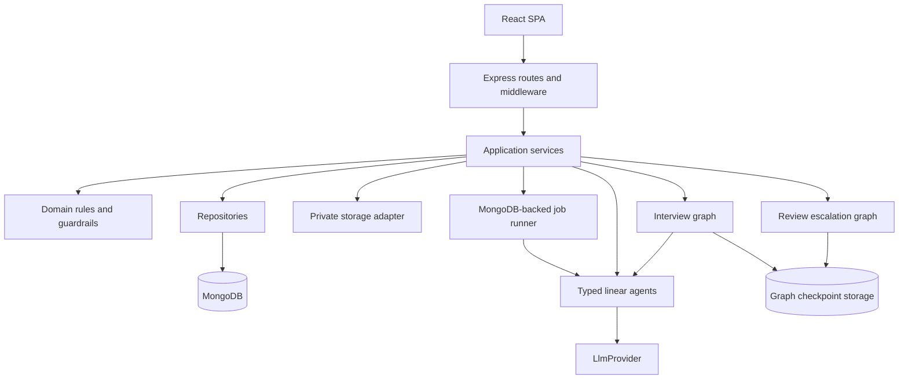

# High-Level Design

## Deployable units

| Unit | Responsibility | Phase |
|---|---|---|
| React SPA | Candidate, coach, and administrator experience; calls only the API | 6 |
| Express API | Modular monolith, authentication, validation, use cases, and REST responses | 3 onward |
| MongoDB | Users, candidate data, records, async job state, and audit metadata | Active persistence |
| MongoDB GridFS | Original resume and job-description uploads | 4 |
| LLM provider | Configured external provider behind a backend adapter | 5 |

The API connects to a hosted MongoDB deployment configured by `MONGODB_URI` and `MONGODB_DB_NAME`. MongoDB stores application records, vector chunks, and upload binaries in GridFS. The API rejects localhost MongoDB URIs outside tests; Docker Compose does not start a local database or mount an application-data volume.

## Component view

## Main runtime flows

### Resume intake

1. Candidate consents to the relevant processing and submits a PDF/DOCX.
2. API authenticates, applies upload limits, sniffs the file type, and stores the file privately.
3. An async job extracts text and stores source text plus parse provenance.
4. Parser output is schema validated and every extracted claim retains source evidence.
5. Candidate retrieves parse status/result and can correct extracted fields.

### Match analysis

1. Service loads resume and job data with `ownerId` constraints.
2. Agent classifies skill evidence; domain code verifies snippets against original source.
3. Domain code computes a versioned weighted score.
4. Result, score breakdown, disclaimer, provenance, and review state are persisted.

### Mock interview and coach review

The interview graph checkpoints between questions and answers. The review graph checkpoints while waiting for the coach. Both graphs store identifiers and workflow state, not duplicate document content; source records remain in their domain collections.

## Availability and failure handling

- API startup requires a reachable MongoDB instance and creates the required indexes.
- Long-running AI tasks return a job identifier; failure state is explicit and pollable.
- Provider errors/timeouts are recorded without returning secrets or raw stack traces.
- Graph interruptions are resumable only while the API process remains running.
- A database or provider outage must not return success-shaped placeholder output.

## Scaling and deployment

The deployment uses hosted MongoDB for shared application state and GridFS file storage. MongoDB supports multiple API processes; the current in-process job runner and graph checkpoints are still process-local and need a durable worker/checkpoint strategy before horizontal scaling.
